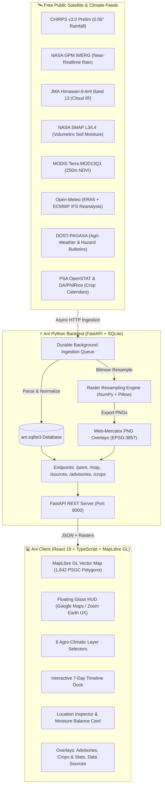

# 🌾 Ani: Philippine Climate & Agriculture Intelligence Platform

> **A Nationwide Satellite, Climate, and Crop Risk Intelligence Platform for El Niño / La Niña Awareness, Drought Monitoring, and Farmer Decision Support in the Philippines.**


---

## 📖 Table of Contents

- [Overview & Agricultural Purpose](#-overview--agricultural-purpose)
  - [The El Niño & La Niña Challenge in the Philippines](#the-el-niño--la-niña-challenge-in-the-philippines)
  - [Why Ani Was Built for Filipino Farmers](#why-ani-was-built-for-filipino-farmers)
  - [Key Questions Ani Answers for Agriculture](#key-questions-ani-answers-for-agriculture)
- [System Architecture](#-system-architecture)
- [Key Features](#-key-features)
- [Agro-Climatic Indicators & Satellite Feeds](#-agro-climatic-indicators--satellite-feeds)
- [Technology Stack](#-technology-stack)
  - [Frontend](#frontend)
  - [Backend & Data Pipeline](#backend--data-pipeline)
  - [Geospatial & Satellite Feeds](#geospatial--satellite-feeds)
  - [Huawei Cloud Ecosystem (Roadmap)](#huawei-cloud-ecosystem-roadmap)
- [Getting Started / How to Run](#-getting-started--how-to-run)
  - [Prerequisites](#prerequisites)
  - [1. Clone Repository](#1-clone-repository)
  - [2. Backend Setup](#2-backend-setup)
  - [3. Frontend Setup](#3-frontend-setup)
  - [4. Access the Application](#4-access-the-application)
- [Data Collection & Synchronization](#-data-collection--synchronization)
- [Testing & Quality Assurance](#-testing--quality-assurance)
- [Troubleshooting & FAQs](#-troubleshooting--faqs)
- [Project Directory Structure](#-project-directory-structure)
- [License & Acknowledgments](#-license--acknowledgments)

---

## 🌾 Overview & Agricultural Purpose

**Ani** (the Tagalog word for *"harvest"* or *"agricultural yield"*) is an end-to-end agro-climatic intelligence dashboard built to help Philippine agriculture anticipate, prepare for, and adapt to climate extremes.

### The El Niño & La Niña Challenge in the Philippines

The Philippines is one of the most climate-vulnerable countries in the world. Its agricultural sector is continuously disrupted by the **El Niño–Southern Oscillation (ENSO)** cycle:

- **🔥 El Niño (Droughts & Dry Spells):**
  - Causes severe decreases in precipitation across Luzon, the Visayas, and Mindanao.
  - Triggers drastic drops in major irrigation dams (e.g., Angat, Pantabangan, Magat), starving gravity irrigation systems.
  - Causes soil moisture depletion, high surface temperature, and atmospheric evaporative demand ($ET_0$) that rapidly exhausts crop roots.
  - Results in stunted vegetative growth, empty grain heads (*"ipan"* in rice), premature corn tassel drying, and total crop failure.
- **🌊 La Niña (Excess Rainfall & Flooding):**
  - Brings intensified monsoon surges (*Habagat* / *Amihan*) and severe tropical depressions.
  - Submerges freshly transplanted paddy fields, rots standing crops, and prevents timely harvesting and sun-drying.

### Why Ani Was Built for Filipino Farmers

While global space agencies (NASA, JMA, ESA, NOAA) collect petabytes of high-resolution Earth observation data daily, this data remains largely trapped in scientific archives, complex formats (HDF5, NetCDF, GeoTIFF), or coarse regional generalities that **smallholder farmers, agricultural extension workers, and municipal agriculturists cannot easily access or interpret**.

**Ani bridges this gap** by:
1. **Covering all 1,642 Philippine cities and municipalities** (PSGC 3Q 2026), providing hyper-local intelligence rather than generic regional averages.
2. **Translating complex satellite observations into direct farming indicators** (rainfall accumulation, soil moisture levels, evapotranspiration water balance, cloud coverage, and NDVI canopy vigor).
3. **Integrating official DOST-PAGASA weather warnings and Agri-Weather forecasts** alongside provincial **PSA OpenSTAT & DA/PhilRice crop calendars** so farmers know exactly when to plant, irrigate, apply fertilizer, or harvest.
4. **Preserving strict scientific integrity**: Ani clearly separates real satellite observations from simulated modes, includes explicit data freshness badges (`Available`, `Stale`, `Cloud-masked`, `Missing`), and performs optical cloud masking so farmers don't confuse cloud shadows with crop blight.

### Key Questions Ani Answers for Agriculture

| Agro-Climatic Question | Indicator / Layer | Farming Decision |
|---|---|---|
| **"Is my soil losing moisture faster than rain can replenish it?"** | Moisture Balance ($Rain - ET_0$) | Schedule supplemental shallow-tube-well (STW) pumping or apply straw mulching to conserve moisture. |
| **"Will there be enough continuous rain to establish wet-season palay?"** | 7-day Rainfall Trend & CHIRPS / IMERG | Delay seedbed preparation or direct seeding until consistent rainfall arrives, avoiding seedling dry-up. |
| **"Is the canopy healthy or are crops suffering from drought stress?"** | MODIS 250 m NDVI Vegetation Index | Inspect yellowing fields, assess crop nitrogen response, or trigger LGU agricultural damage reports. |
| **"Are heavy cloud cover and moisture creating fungal disease risks?"** | Himawari-9 IR Cloud Cover & PAGASA Agri-Weather | Monitor for rice blast (*Magnaporthe oryzae*), sheath blight, or bacterial leaf streak during prolonged overcast periods. |
| **"Are official typhoon or heavy rainfall warnings in effect for my province?"** | DOST-PAGASA 24-hr Synopsis & Hazards | Clear irrigation drainage canals, reinforce nursery greenhouses, or accelerate grain harvest ahead of landfall. |

---

## 🏛 System Architecture

Ani employs a decoupled, asynchronous micro-architecture designed for resilience under spotty connectivity:



---

## ✨ Key Features

1. **Full-Screen Interactive Map with Floating HUD:**
   - Edge-to-edge (`100% × 100dvh`) zero-scroll workspace inspired by modern geospatial interfaces (Google Maps, Zoom Earth).
   - Glassmorphic floating toolbars, collapsible layer controls, location search, and bottom timeline dock.
2. **Nationwide 1,642 Municipal Highlighting (90% Static Fill):**
   - Every Philippine municipality and city is displayed with real, live data at 90% opacity across both **Raster grid** mode and **Municipal fill** mode—no unrepresented islands or provinces.
3. **Six Core Agro-Climatic Layers:**
   - 🌧 **Rainfall (`mm`):** Satellite-gauge precipitation from CHIRPS v3 and NASA GPM IMERG.
   - ☁️ **Cloud cover (`%`):** Clean-IR cloud-top brightness imagery from JMA Himawari-9.
   - 🌡 **Temperature (`°C`):** Surface air temperature from high-resolution ECMWF reanalysis.
   - 💧 **Evapotranspiration (`mm`):** FAO-56 Penman-Monteith reference crop water demand ($ET_0$).
   - 🌿 **Vegetation health (`NDVI`):** MODIS Terra 250 m greenness index with optical cloud masking.
   - 🪴 **Soil moisture (`m³/m³`):** Volumetric topsoil and root-zone water content from NASA SMAP.
4. **Water Deficit & Drought Balance Calculator:**
   - Automatically computes daily and 7-day cumulative $Rain - ET_0$ moisture balance in the location details card, signaling whether crops are entering a net water deficit.
5. **Official DOST-PAGASA Advisories:**
   - Interactive sheet displaying the latest 24-hour weather synopsis, regional weather hazards, specialized agricultural weather advisories (leaf wetness, relative humidity), and PDF bulletins.
6. **Crop Calendars & PSA Farm Statistics:**
   - Provincial Palay and Corn production tonnage, area harvested, and average yields from PSA OpenSTAT coupled with wet- and dry-season planting/harvest schedules from the Department of Agriculture (DA) and PhilRice.
7. **Complete Data Freshness Audit:**
   - Dedicated **Data sources** panel reporting coverage date ranges, stored raster counts, and canonical freshness statuses (`Available`, `Stale`, `Cloud-masked`, `Missing`) across all 11 data feeds.
8. **Bilingual Search & Geolocation:**
   - Intelligent search matching both formal names and conversational terms (e.g., searching `"cebu city"` ranks `Cebu City / City of Cebu` at #1).
   - Automatically centers on the user's current Philippine location upon landing.
9. **Dual Atmospheric Themes:**
   - **Light mode:** Botanical mineral celadon mist (`#c6d7d5` sea, `#f1f4f1` land) for sunny daytime outdoor field work.
   - **Dark mode:** Abyssal petrol slate (`#0b1b22` sea, `#142b34` land) modeled after Zoom Earth for evening and night monitoring.

---

## 🛰 Agro-Climatic Indicators & Satellite Feeds

Ani integrates 11 open, free satellite and climate data sources without requiring paid API keys:

| Feed / Source | Parameter | Resolution / Revisit | Agricultural Role |
|---|---|---|---|
| **CHIRPS v3.0 Prelim** | Rainfall (`mm`) | `0.05°` (~5.5 km), Daily | Baseline satellite-station rainfall dataset with high historical consistency. |
| **NASA GPM IMERG** | Near-Realtime Precipitation | `0.10°` (~10 km), Half-hourly | Fills the latency gap between recent days and CHIRPS release. |
| **JMA Himawari-9 AHI Band 13** | Cloud-Top Cover (`%`) | `2 km`, 10-minute geostationary | Real infrared satellite cloud imagery indicating convective storm activity. |
| **NASA SMAP L3/L4** | Volumetric Soil Moisture (`m³/m³`) | `9–36 km`, 2–3 days | Directly detects moisture in the root zone before plant stress becomes visible. |
| **MODIS Terra MOD13Q1** | Vegetation Index (`NDVI`) | `250 m`, 8/16-day composite | Tracks canopy vigor; includes quality assurance to filter out optical cloud masking. |
| **Open-Meteo (ERA5 + IFS)** | Temperature & $ET_0$ (`°C`, `mm`) | `0.25°` (~25 km), Hourly/Daily | Seamless reanalysis providing reference evapotranspiration (crop water demand). |
| **NASA POWER** | Agroclimatology (`EVPTRNS`, `T2M`) | `0.5° × 0.625°`, Daily | Global solar radiation and agro-climate backup dataset. |
| **DOST-PAGASA** | Weather Hazards & Agri-Weather | Regional / Provincial bulletins | Official Philippine warnings, cyclone tracks, and farm-level humidity/leaf wetness. |
| **PSA OpenSTAT** | Provincial Palay / Corn Stats | Quarterly / Annual surveys | Ground truth production tonnage, yield per hectare, and seasonal harvest shares. |
| **DA & PhilRice** | Cropping Schedules | Agro-climatic zones | Cropping calendars defining optimal planting, vegetative, and harvesting stages. |
| **PSGC 3Q 2026** | Administrative Boundaries | 1,642 Cities & Municipalities | Canonical geospatial boundaries for all local government units. |

> [!NOTE]
> **Data Integrity Rule:** In **Collected data** mode (the default), Ani never invents, hallucinates, or synthetically fills missing data. If an observation has not yet been published by upstream satellites, it is displayed as `—`. If thick clouds obscure optical NDVI sensors, it is explicitly flagged as `Cloud-masked`. The **Simulated demo** mode is kept strictly isolated.

---

## 🛠 Technology Stack

### Frontend
- **Framework:** [React 19](https://react.dev/) + [TypeScript](https://www.typescriptlang.org/) for robust, type-safe reactive UI components.
- **Build Tool:** [Vite 6](https://vitejs.dev/) with Hot Module Replacement (HMR) and optimized rollup production bundles.
- **Map Engine:** [MapLibre GL JS v5](https://maplibre.org/) hardware-accelerated WebGL vector map rendering with georeferenced raster image overlay layers.
- **Basemaps:** OpenFreeMap / OpenMapTiles vector tiles (fully keyless, zero tracking).
- **Icons:** [Lucide React](https://lucide.dev/) for crisp, accessible UI icons.
- **Typography:** `@fontsource/public-sans` for dense, legible tabular and map typography.
- **CSS Architecture:** Pure modern CSS utilizing CSS custom properties, `@starting-style` transitions, `color-mix()`, container-friendly flexbox/grid, and `@media (forced-colors: active)` support for Windows High Contrast Mode.
- **Testing:** [Playwright](https://playwright.dev/) for automated multi-viewport cross-browser regression testing.

### Backend & Data Pipeline
- **Runtime:** Python 3.10+
- **API Framework:** [FastAPI](https://fastapi.tiangolo.com/) with asynchronous route handling and auto-generated OpenAPI / Swagger docs.
- **ASGI Server:** [Uvicorn](https://www.uvicorn.org/) with single-worker durable background queue execution.
- **Database:** [SQLite3](https://www.sqlite.org/) (bundled in Python standard library) with WAL mode for zero-configuration, durable local storage of 1,642 municipal boundaries, observations, source runs, advisories, and crop statistics.
- **Scientific Computing & Rasters:**
  - `numpy`: Fast multidimensional array math and spatial grid conversions.
  - `Pillow` (PIL): 2D bilinear resampling to Web-Mercator (`EPSG:3857`), 3×3 spatial grid smoothing, and RGBA PNG raster tile creation.
- **Networking & Security:** `httpx` with `truststore` for resilient asynchronous HTTPS requests using the host operating system's native certificate trust store.
- **Testing:** `pytest` unit and integration test suite.

### Geospatial & Satellite Feeds
- **Coordinate Reference System:** EPSG:4326 (WGS84) for geographic municipal polygons and EPSG:3857 (Web-Mercator) for map tile raster overlays.
- **Spatial Coverage:** Full Philippine archipelago bounding box `[116.8°E, 4.5°N, 126.8°E, 21.3°N]`.

### Huawei Cloud Ecosystem (Roadmap)
As part of the platform's planned scaling on Huawei Cloud infrastructure:
- **Huawei Cloud OBS (Object Storage Service):** Offloading processed nationwide PNG rasters and cached satellite granules.
- **ModelArts & MindSpore:** Training ConvLSTM and Transformer neural networks for multi-day gridded rainfall and drought stress forecasting.
- **Huawei Cloud ECS / FunctionGraph:** Hosting serverless data sync pipelines and API workloads.
- **Chatbot Alerts (Telegram / Messenger):** Direct messaging to farmers and agricultural extension workers using MindSpore inference.

---

## 🚀 Getting Started / How to Run

Follow these instructions to run Ani locally on your machine (**Windows, macOS, or Linux**).

### Prerequisites

Ensure you have the following installed on your system:
- **Python:** Version `3.10` or higher (`python --version`)
- **Node.js:** Version `18.0.0` or higher (`node --version`)
- **npm:** Bundled with Node.js (`npm --version`)
- **Git:** (`git --version`)

---

### 1. Clone Repository

```bash
git clone https://github.com/your-username/ani-climate-platform.git
cd ani-climate-platform
```
*(Or navigate to your project directory, e.g. `d:\HuaweiInnov2026`).*

---

### 2. Backend Setup

The backend runs on Python with FastAPI and SQLite.

1. **Open a terminal** and navigate to the `backend` folder:
   ```bash
   cd backend
   ```

2. **(Recommended) Create and activate a Python virtual environment:**
   - **Windows (PowerShell):**
     ```powershell
     python -m venv venv
     .\venv\Scripts\Activate.ps1
     ```
   - **macOS / Linux:**
     ```bash
     python3 -m venv venv
     source venv/bin/activate
     ```

3. **Install dependencies:**
   ```bash
   python -m pip install --upgrade pip
   pip install -r requirements.txt
   ```

4. **Initialize configuration:**
   Copy the sample environment file (do not overwrite if `.env` already exists):
   - **Windows (PowerShell):**
     ```powershell
     if (-not (Test-Path .env)) { Copy-Item .env.example .env }
     ```
   - **macOS / Linux:**
     ```bash
     cp -n .env.example .env
     ```

   > [!TIP]
   > **No API keys are required!** All Phase 1 satellite feeds (CHIRPS, NASA GIBS, Himawari-9, SMAP, Open-Meteo, PAGASA, PSA) function out of the box with open endpoints.

5. **Start the backend server:**
   ```bash
   python run.py
   ```
   *The backend will initialize the SQLite database (`data/ani.sqlite3`), bundle the 1,642 Philippine municipality boundaries, and start listening on `http://127.0.0.1:8000`.*

---

### 3. Frontend Setup

The frontend runs on React, TypeScript, Vite, and MapLibre GL.

1. **Open a second terminal** and navigate to the `frontend` folder:
   ```bash
   cd frontend
   ```

   > [!IMPORTANT]
   > Make sure you are inside the `frontend` directory before running `npm install`. Running `npm install` in the project root will result in an `ENOENT` error because `package.json` lives in `frontend/`.

2. **Install Node packages:**
   ```bash
   npm install
   ```

3. **Start the Vite development server:**
   ```bash
   npm run dev
   ```
   *The Vite server will start and output a local URL, typically `http://127.0.0.1:5173/`.*

---

### 4. Access the Application

- 🌐 **Web Dashboard:** Open your browser and navigate to **[http://localhost:5173](http://localhost:5173)**
- 📚 **Interactive Swagger API Documentation:** Visit **[http://127.0.0.1:8000/docs](http://127.0.0.1:8000/docs)** to test backend endpoints directly.

---

## 🔄 Data Collection & Synchronization

Once the dashboard is open, you can fetch live agro-climatic data:

1. **Sync Nationwide Satellites & Advisories:**
   - In the top navigation bar, click the **"Sync satellites & advisories"** button with the refresh icon.
   - This triggers the backend to asynchronously query CHIRPS rainfall, GPM IMERG, Himawari-9 cloud imagery, SMAP soil moisture, MODIS NDVI, DOST-PAGASA bulletins, and PSA provincial crop statistics.
2. **Collect Data for a Specific Municipality:**
   - Click any municipality on the map, or search for it in the search bar (e.g., *"Cabanatuan City"*, *"Tarlac City"*, *"Bacolod"*).
   - In the top bar, click **"Collect [Municipality Name]"**. The backend will immediately fetch and store the latest 7-day weather and soil series for that coordinate.
3. **Nationwide Reanalysis Collection:**
   - Click the **Data sources** tab in the top bar.
   - Click **"Collect nationwide weather"** to run a background queue across all 1,642 Philippine local government units.

---

## 🧪 Testing & Quality Assurance

Both the backend and frontend include automated test suites to guarantee data integrity, spatial accuracy, and cross-device compatibility.

### 1. Backend Pytest Suite
Run the backend tests to verify unit conversions, spatial raster creation, and source priority:
```bash
cd backend
python -m pytest tests -q
```
*Expected result: 16+ passed tests verifying valid zeros, evapotranspiration FAO-56 conversion, optical cloud masking, and Mercator raster generation.*

### 2. Geographic Integrity Verification
Verify all 1,642 municipality polygons, interior point containment, duplicate name resolution, and ocean click rejection:
```bash
cd frontend
node verify-geography.mjs
```

### 3. Playwright Multi-Viewport Browser Verification
Run headless browser verification across desktop (`1536×740`), compact desktop (`1440×860`), and mobile (`390×844`) screens:
```bash
cd frontend
npm run build
node verify.mjs
```
*Checks zero horizontal scroll, full-screen map layout, 90% static layer fill, search functionality, dark/light theme switching, and network error isolation.*

---

## ❓ Troubleshooting & FAQs

### Q1: `[Errno 10048] error while attempting to bind on address ('127.0.0.1', 8000)`
**Cause:** Another instance of Python or Uvicorn is already running on port 8000.  
**Solution:**
- **On Windows (PowerShell):**
  ```powershell
  # Find the process using port 8000
  netstat -ano | findstr :8000
  # Stop the process by PID (replace <PID> with the number from the last column)
  Stop-Process -Id <PID> -Force
  ```
- **On macOS / Linux:**
  ```bash
  lsof -ti :8000 | xargs kill -9
  ```
- Then re-run `python run.py`.

---

### Q2: `npm error ENOENT Could not read package.json`
**Cause:** You ran `npm install` from the root project directory instead of the `frontend` subfolder.  
**Solution:**
```bash
cd frontend
npm install
npm run dev
```

---

### Q3: Clicking "Sync satellites & advisories" says "Backend unavailable"
**Cause:** The frontend cannot communicate with the FastAPI backend.  
**Solution:**
1. Check that your backend terminal is running and displays:
   `INFO: Application startup complete. Uvicorn running on http://127.0.0.1:8000`
2. Test the health endpoint in your browser: [http://127.0.0.1:8000/api/health](http://127.0.0.1:8000/api/health). It should return `{"status":"ok","areas":1642,...}`.
3. If port 8000 is running on a different port, set `ANI_API_URL` in `frontend/vite.config.ts`.

---

### Q4: Why do some vegetation (NDVI) values show "Cloud-masked"?
**Explanation:** This is an intentional feature! Satellite optical sensors (such as MODIS Terra) cannot penetrate thick tropical clouds. When clouds are detected, Ani marks the pixel as `Cloud-masked` with `value = null`. This prevents misleading farmers into believing their healthy green crops have died when the satellite merely saw a cloud.

---

### Q5: Are any paid subscriptions or credit cards needed?
**No.** All Phase 1 providers used by Ani (Open-Meteo non-commercial, NASA GIBS, UCSB CHIRPS, JMA Himawari-9, DOST-PAGASA, PSA OpenSTAT) are public and free.

---

## 📁 Project Directory Structure

```text
HuaweiInnov2026/
├── README.md                      # This documentation
├── PROJECT_PLAN.md                # Competition scope and technical plan
├── assets/                        # Logos and static media assets
│   └── images/
│       └── logo.jpg               # Ani official brand mark
├── backend/                       # Python FastAPI Backend
│   ├── run.py                     # Entry point for backend server (port 8000)
│   ├── requirements.txt           # Python package dependencies
│   ├── .env.example               # Template environment configuration
│   ├── README.md                  # Backend-specific architecture notes
│   ├── ani/                       # Core application package
│   │   ├── config.py              # Configuration and paths
│   │   ├── db.py                  # SQLite3 database schemas and queries
│   │   ├── main.py                # FastAPI routes and middleware
│   │   ├── providers.py           # Upstream data collectors (CHIRPS, GPM, SMAP, etc.)
│   │   ├── rasters.py             # Image processing and Web-Mercator resampling
│   │   ├── spatial.py             # GeoJSON boundary parsing and point-in-polygon
│   │   └── tasks.py               # Background job queue runner
│   └── tests/                     # Automated pytest test cases
├── data/                          # Persistent data directory
│   ├── ani.sqlite3                # Local SQLite database (1,642 municipalities & data)
│   ├── raw/                       # Cached raw responses from upstream APIs
│   └── processed/                 # Generated Web-Mercator PNG satellite rasters
└── frontend/                      # React 19 + TypeScript Frontend
    ├── package.json               # Node.js dependencies and scripts
    ├── vite.config.ts             # Vite configuration and backend /api proxy
    ├── index.html                 # HTML application entry point
    ├── README.md                  # Frontend-specific notes
    ├── verify.mjs                 # Playwright end-to-end verification script
    ├── verify-geography.mjs       # Municipal boundary validation script
    ├── public/                    # Static assets (vector basemap styles, logo, etc.)
    │   ├── basemap-light.json     # Mineral celadon light basemap
    │   ├── basemap-dark.json      # Petrol slate dark basemap
    │   └── logo.jpg               # Brand mark icon
    └── src/                       # React TypeScript source code
        ├── App.tsx                # Main HUD application layout and modals
        ├── MapView.tsx            # MapLibre GL JS vector and raster integration
        ├── CollectionBar.tsx      # Top bar sync and collection controls
        ├── styles.css             # Glassmorphic responsive styles & themes
        ├── geography.ts           # PSGC 3Q 2026 municipal boundaries and search
        ├── useCollectedData.ts    # React state hook for API data & background jobs
        └── types.ts               # TypeScript interfaces for climate data
```

---

## 📄 License & Acknowledgments

- **Developed for:** Philippine Agricultural Resilience, El Niño & La Niña Awareness, and Huawei Innovation Track.
- **Data Providers:**
  - **CHIRPS:** Climate Hazards Center, UC Santa Barbara.
  - **NASA GPM, SMAP, MODIS, GIBS:** NASA Earth Science Data and Information System (ESDIS).
  - **JMA Himawari-9:** Japan Meteorological Agency / NICT.
  - **Open-Meteo & ECMWF:** Open-Meteo weather API and Copernicus Climate Change Service.
  - **DOST-PAGASA:** Philippine Atmospheric, Geophysical and Astronomical Services Administration.
  - **PSA & DA / PhilRice:** Philippine Statistics Authority and Department of Agriculture.
  - **Basemaps:** OpenFreeMap and OpenMapTiles contributors.